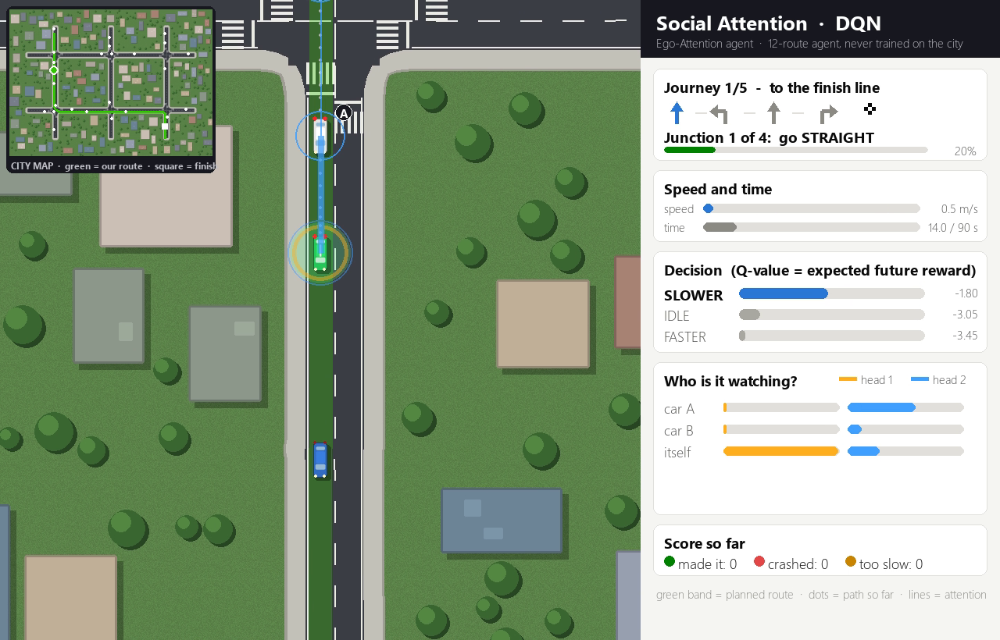
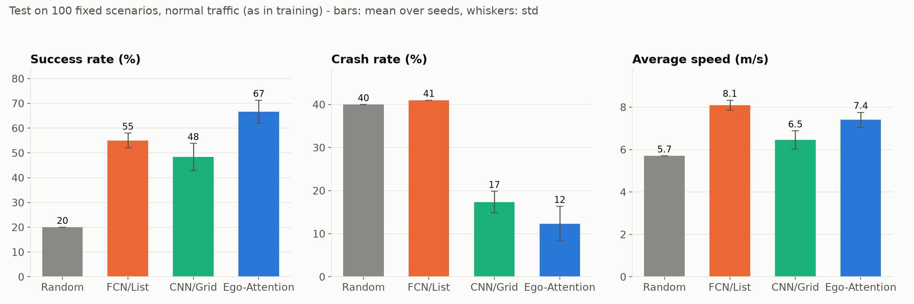
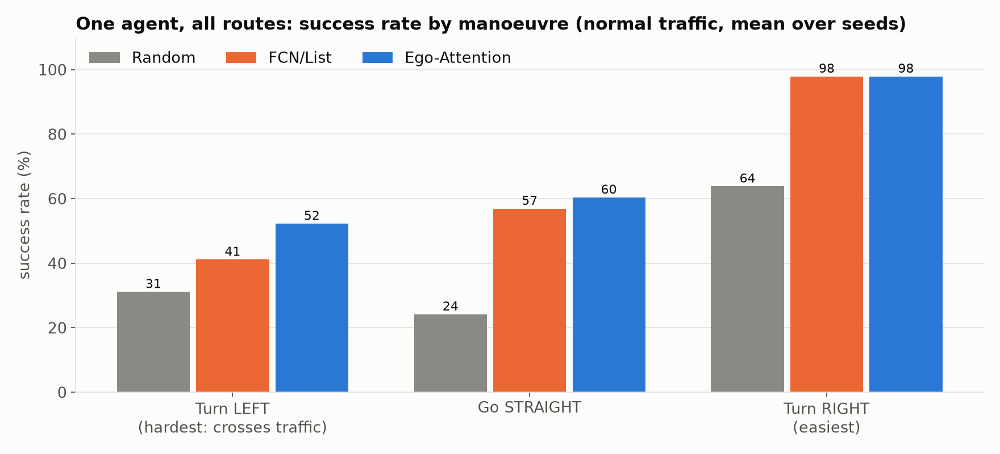
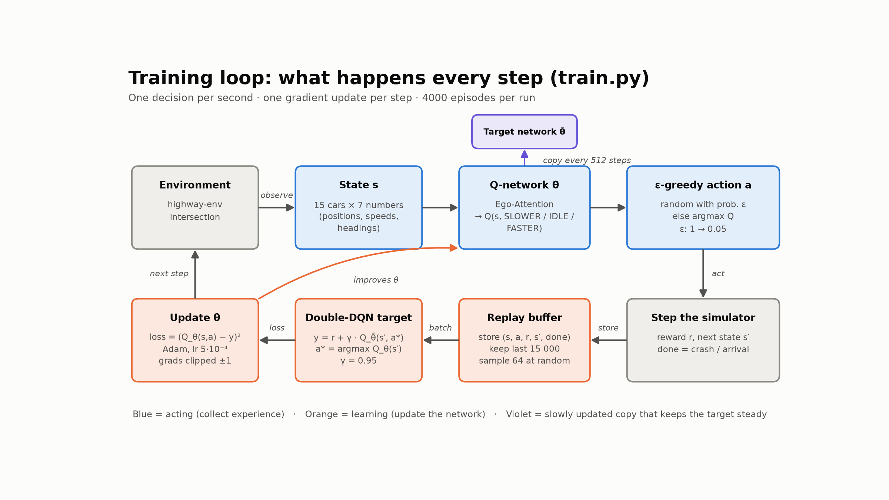
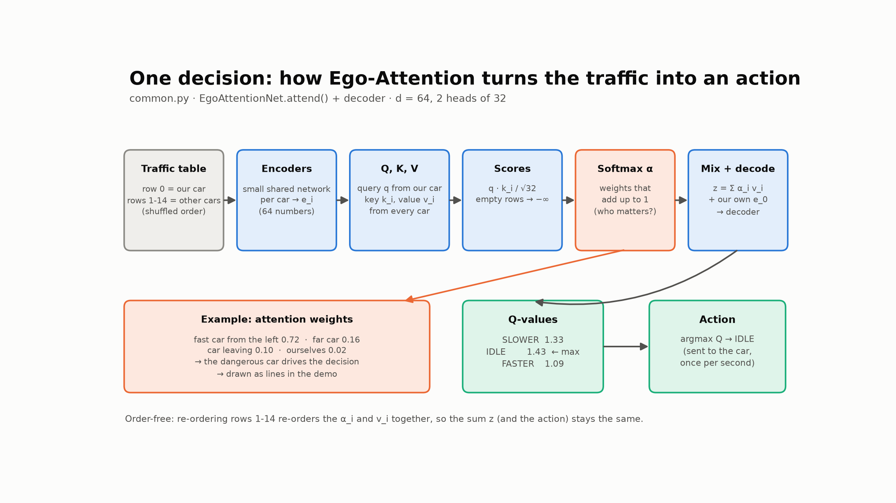

# AttentionDrive 🚗

**Teaching a self-driving car where to look.**

A PyTorch reproduction of [*Social Attention for Autonomous Decision-Making in Dense Traffic*](https://arxiv.org/abs/1911.12250)
(Leurent & Mercat, NeurIPS 2019 ML4AD workshop). A car must turn at a busy junction with no traffic light. A
**DQN** agent learns when to slow down, wait or go, and an **ego-attention** network decides which surrounding
cars matter. We reproduce the paper and extend it to **12 routes** and a **6-junction city journey**.



*Green band = planned route · coloured lines = attention (which cars the agent is watching) · panel = Q-values and
decision · mini-map of the city. Video: [`videos/journey.mp4`](videos/journey.mp4)*

---

## Results

### 1. Reproducing the paper (left turn, 3 seeds × 4000 episodes, 100 unseen test scenarios)

| Agent | Success | Crash | Too slow | Behaviour (as in the paper's Figure 4) |
|---|---|---|---|---|
| Random | 20 % | 40 % | 40 % | - |
| FCN/List | 55 % | **41 %** | 4 % | fast and "blind": crashes often |
| CNN/Grid | 48 % | 17 % | **34 %** | over-cautious "freezing robot" |
| **Ego-Attention** | **67 %** | **12 %** | 21 % | waits when needed and uses the gaps |

In denser traffic than in training, attention still wins (42 % success / 17 % crash vs FCN 32 % / 61 %).



### 2. Extension: one agent for all 12 routes (goal conditioning)
The paper trains for a single left turn and suggests (Section 4) adding the destination as an input. We did that:
start on any of 4 roads × go left / straight / right. Each car gets the direction to its destination - the **goal**
for our car, a **turn signal** for the others. Attention **halves the crash rate**: 18 % vs 34 % for FCN
(70 % vs 65 % success). The gain is biggest on left turns across traffic (52 % vs 41 %).



### 3. Extension: a long journey through a city
Six copies of the intersection form a 2 × 3 grid. Each journey crosses 3-4 junctions to a finish line. A route planner
(breadth-first shortest path) chooses the turns, and the attention agent decides *when* to go. At every junction the
agent sees positions relative to that junction, so a skill learned at one junction transfers to the whole city.

| 100 journeys, identical traffic | Finished | Crashed |
|---|---|---|
| Random | 37 % | 43 % |
| FCN, zero-shot | 34 % | 66 % |
| **Ego-Attention, zero-shot** (never trained on the city) | **52.5 %** | 45.5 % |
| Ego-Attention, fine-tuned 600 episodes | 44 % | 55.5 % |

Errors add up over long journeys (≈ 0.85 per junction → 0.85^3.4 ≈ 0.57). Fine-tuning made the agent *more aggressive*,
so it did worse - we report it as an honest negative result.

---

## How it works

| | |
|---|---|
| **State** | 15 cars × 7 features (presence, x, y, vx, vy, cos θ, sin θ), our car first, others in random order |
| **Actions** | SLOWER / IDLE / FASTER, once per second (steering is automatic) |
| **Reward** | up to +1 per second for speed, −5 for a crash, +1 for arriving |
| **Algorithm** | Double DQN, replay buffer 15k, target network every 512 steps, γ = 0.95, ε: 1 → 0.05 |
| **Networks** | FCN/List, CNN/Grid and Ego-Attention, ~30k weights each (matching the paper's Table 1) |

Ego-attention: our car makes a query, every car a key and a value;
α_i = softmax(q·k_i / √d), output = Σ α_i v_i (+ residual) → decoder → 3 Q-values.
The sum makes the network independent of the car order and of the number of cars.




---

## Quick start

```bash
git clone https://github.com/mindhacker1098/AttentionDrive.git
cd AttentionDrive
python -m venv venv
venv\Scripts\activate            # Linux/macOS: source venv/bin/activate
pip install -r requirements.txt
```

**Watch the trained agents** (models are included in `runs/`):
```bash
python demo.py --run runs/multi_attention_s2 --journey   # long city journey (F = whole-city camera)
python demo.py --run runs/multi_attention_s2             # 12-route agent at one junction
python demo.py --run runs/attention_s1                   # the paper's left-turn agent
python demo.py --run runs/fcn_s1                         # "blind" FCN baseline for comparison
```
Keys: `SPACE` pause · `N` next episode · `F` camera · `Q` quit. Add `--video out.mp4` to record instead.

**Train and evaluate from scratch:**
```bash
python run_all.py                                       # paper task: 3 networks × 3 seeds (~1-1.5 h on 8 cores)
python run_all.py --task multi --models attention fcn --seeds 1 2 --episodes 6000 --jobs 4
python evaluate.py --all            # 100 fixed test scenarios (add --dense for heavy traffic)
python evaluate_journey.py --episodes 100
python plot.py                      # figures in plots/
```

---

## Project structure

| File | What it does |
|---|---|
| `common.py` | environments (paper task + 12-route task), the three networks, replay buffer, ε schedule |
| `train.py` | Double-DQN training loop |
| `run_all.py` | runs several trainings in parallel, then evaluates and plots |
| `evaluate.py`, `evaluate_journey.py` | fixed test scenarios, success / crash / timeout rates |
| `journey.py` | 6-junction city, route planner, junction-relative observation |
| `demo.py`, `city_render.py` | live demo with attention lines and a custom city renderer |
| `plot.py`, `make_flow.py` | result figures and flow diagrams |
| `make_deck*.py`, `make_member_scripts.py` | presentation slides and speaker scripts |
| `runs/` | trained models (`model.pt`), configs and training logs (`progress.csv`) |
| `results/`, `plots/`, `videos/`, `slides/` | evaluation CSVs, figures, demo videos, scripts (PDF) |

Hyper-parameters are taken from the authors' configs in [eleurent/rl-agents](https://github.com/eleurent/rl-agents);
the simulator is [highway-env](https://github.com/Farama-Foundation/HighwayEnv) (`intersection-v0`).

## Limitations
Simulator only · other drivers follow simple rules · the agent controls speed only (no lane changes, so it cannot
drive around obstacles) · 3 seeds instead of the paper's 120.

## Reference
```bibtex
@inproceedings{leurent2019social,
  title     = {Social Attention for Autonomous Decision-Making in Dense Traffic},
  author    = {Leurent, Edouard and Mercat, Jean},
  booktitle = {Machine Learning for Autonomous Driving Workshop at NeurIPS},
  year      = {2019}
}
```

---
Course project for **CS6109 Reinforcement Learning**, IIT Patna - team **Bandit LAB**:
Shakti Prasad Nahak, Akash Prasad, Gourav Rajak, Dhruv Kumar Singh.
